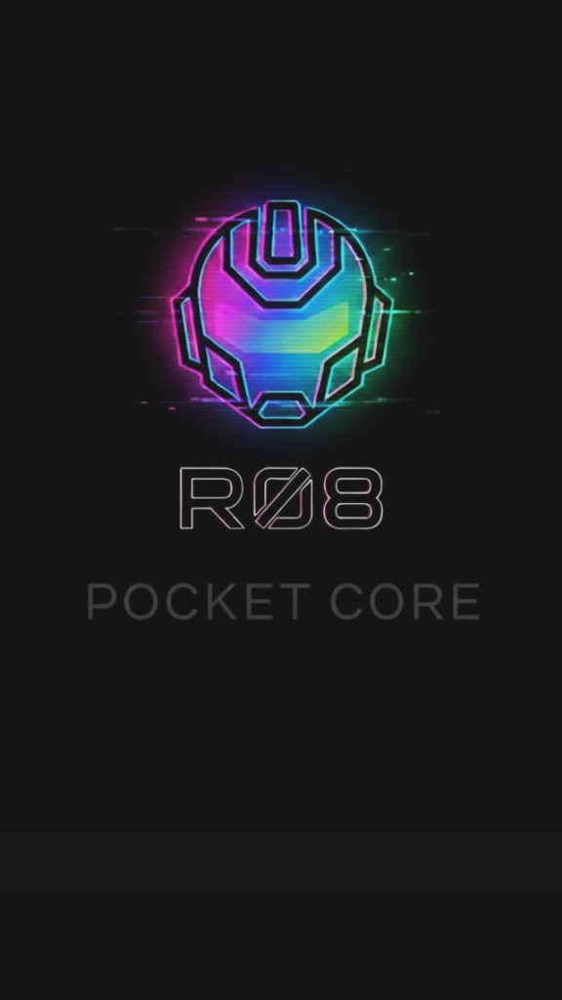

<p align="center">
  
</p>

# 🇪🇸 gpTommy-32k-ES — Native 32,768-Token Vocabulary & Tokenizer v2 for Español (Spanish) (Spagnolo)

[](https://www.sentinelhub.eu)
[](https://www.sentinelhub.eu)
[](https://github.com/Thomasseri/gpTommy-32k-ES)
[](https://github.com/Thomasseri/gpTommy-32k-ES)
[](https://github.com/Thomasseri/gpTommy-32k-ES)
[-orange.svg)](https://www.sentinelhub.eu)

> **Deterministic 32,768-token (`32k`) lexical vocabulary and Tokenizer v2 (Implicit Space + 100% Lossless Case) specifically engineered for the Español (Spanish) (`es`) language.**  
> **Author & Creator:** Thomas Seri (Sentinel)  
> **Reference Ecosystem:** [Sentinel LifeOS](https://www.sentinelhub.eu) & **Sentinel R-08** Geodesic Model Family

---

## 🚀 Tokenizer v2 Update & Corrections Log (7 November 2026)

This repository now includes **Tokenizer v2 (`v2.0.0`, `implicit_space=True` by default)**, which eliminates wasted single-space tokens between words and preserves 100% lossless capitalization, while keeping optional `implicit_space=False` compatibility for v1 checkpoints.

| # | Aspect | Tokenizer v1 (Legacy) | **Tokenizer v2 Updated (`v2.0.0`, default)** | Status |
|---|---|---|---|---|
| 1 | `gptommy_tokenizer.py` | Had a `SyntaxError` (`from __future__ import annotations` placed after the license header) | **Fixed and upgraded to `v2.0.0`** (`implicit_space=True` by default, `implicit_space=False` for v1 compatibility) | ✅ **Fixed & Active** |
| 2 | Lossless round-trip (`decode(encode(text)) == text`) | Returned lowercased text (`"El rodamiento..."` → `"el rodamiento..."`) | **100% Lossless (`decode(encode(text)) == text`)**, using case prefix markers `ID 6` (TitleCase, e.g. `"El"`) and `ID 5` (ALLCAPS, e.g. `"PLC"`, `"R08"`) | ✅ **100% Lossless in v2** |
| 3 | Sequence length & space handling | Emitted a separate `<spazio>` token (`ID 10`) for every space (`32` tokens on the 14-word Spanish example sentence; `2.33` tokens/word on the 177 Italian test texts) | **Implicit single space between words** (`ID 10 = <attaccato>` only when gluing sub-pieces or punctuation; `ID 9` for extra spaces): **25 tokens (-21.9%)** on the Spanish example sentence (`1.85` tokens/word, `-20.4%` tokens on the 177 Italian test texts) | ✅ **Tokenizer v2 Active** |

---

> ### 💼 Investment, Compute Grants & Enterprise Licensing (Investimenti & Partnership Industriali)
> 🇬🇧 **Sentinel** is scaling the **Geodesic Pyramidal Sphere Architecture (`R-08`)** from 50M to **110M–1B+ parameters**, with **a patent application filed at the Italian Patent and Trademark Office (UIBM)**.  
> **Open to Seed / Deep-Tech Investment, GPU/TPU Compute Grants, and Enterprise R&D Partnerships.**  
> 🇮🇹 **Aperto a Investimenti Seed / Deep-Tech, Grant Computazionali GPU/TPU e Licenze Industriali Enterprise.**  
> 📩 **Contact Founder & Inventor Thomas Seri:** 🌐 **[www.sentinelhub.eu](https://www.sentinelhub.eu)** | 🐙 **[GitHub (@Thomasseri)](https://github.com/Thomasseri)** | 🤗 **[Hugging Face (@SentinelHub)](https://huggingface.co/SentinelHub)** | 💬 **[Open an Inquiry / Issue](https://github.com/Thomasseri/R-08/issues/new)**

---

## 🌍 Sentinel gpTommy 32k European Language Suite & R-08 Models

The **gpTommy 32k** family provides native whole-word `SSvvv` vocabularies (`32,768` tokens each, with 100% shared control/space/numeric/alphabet IDs) across the 5 major European languages:

* 🇮🇹 **Italiano (`gpTommy-32k`):** [GitHub](https://github.com/Thomasseri/gpTommy-32k) | [Hugging Face](https://huggingface.co/SentinelHub/gpTommy-32k)
* 🇬🇧 **English (`gpTommy-32k-EN`):** [GitHub](https://github.com/Thomasseri/gpTommy-32k-EN) | [Hugging Face](https://huggingface.co/SentinelHub/gpTommy-32k-EN)
* 🇩🇪 **Deutsch (`gpTommy-32k-DE`):** [GitHub](https://github.com/Thomasseri/gpTommy-32k-DE) | [Hugging Face](https://huggingface.co/SentinelHub/gpTommy-32k-DE)
* 🇫🇷 **Français (`gpTommy-32k-FR`):** [GitHub](https://github.com/Thomasseri/gpTommy-32k-FR) | [Hugging Face](https://huggingface.co/SentinelHub/gpTommy-32k-FR)
* 🇪🇸 **Español (`gpTommy-32k-ES`):** [GitHub](https://github.com/Thomasseri/gpTommy-32k-ES) | [Hugging Face](https://huggingface.co/SentinelHub/gpTommy-32k-ES)

### Related Sentinel R-08 Geodesic Language Models:
* 🤖 **Sentinel R-08 v7 (Pyramid 44.5M):** [GitHub](https://github.com/Thomasseri/R-08) | [Hugging Face](https://huggingface.co/SentinelHub/R-08)
* 🚀 **Sentinel R-08 v7.2 (51.6M with 12 Icosahedral Hubs):** [GitHub](https://github.com/Thomasseri/R-08-v7.2) | [Hugging Face](https://huggingface.co/SentinelHub/R-08-v7.2)
* 🌟 **Sentinel R-08 v7.2a DA ZERO (51.6M 82.51% BLiMP-IT, migliore tra gli R-08):** [GitHub](https://github.com/Thomasseri/R-08-v7.2a) | [Hugging Face](https://huggingface.co/SentinelHub/R-08-v7.2a)

---

## 🎯 Why `gpTommy-32k-ES` is Different from Statistical Subword Tokenizers

Traditional statistical BPE tokenizers fragment words into arbitrary sub-syllables, inflating context length and computational cost while increasing spelling hallucinations in compact neural models.

**gpTommy-32k-ES** adopts a deterministic, structured lexical approach:
* Contains **29,775 complete native Español (Spanish) words and morphemes** (**90.9%** of the vocabulary), covering base lemmas, plurals, conjugated verbs, and scientific/industrial terminology.
* Includes the **complete uppercase/lowercase/accented Latin alphabet (`A..Z`)**, **all single digits (`0..9`) and two-digit numbers (`00..99`)**, **spaces/newlines/tabs (`<spazio>`, `<riga>`, `<tab>`)**, **punctuation and math operators**, and **35 special AI/Chat/Reasoning control tokens (`<|user|>`, `<|assistant|>`, `<|think|>`)** at the exact same fixed IDs as the entire `gpTommy` suite.

---

## 📚 Card-Index Architecture: The 5-Digit `SSvvv` System

The vocabulary uses a deterministic 5-digit index `SSvvv` (`00000` .. `32767`):
* **`SS` (Card / Scheda `00`..`32`)**: Identifies the category or initial alphabet letter (`01`..`26` = **A..Z**).
* **`vvv` (Row `000`..`999`)**: Identifies the specific entry within that card.

| Card (`SS`) | Global ID Range | Primary Content | Token Examples |
| :---: | :---: | :--- | :--- |
| **`00`** | `00000` – `00999` | Special AI tokens, punctuation, digits `0-9`, math symbols | `<\|user\|>`, `<\|assistant\|>`, `<\|think\|>`, `<spazio>`, `+`, `-`, `=`, `*` |
| **`01`** | `01000` – `01999` | Letter **A** (alphabet headers + native Spanish words) | `así`, `años`, `ahora`, `antes`, `aunque`, `además`, `automatización` |
| **`03`** | `03000` – `03999` | Letter **C** | `con`, `como`, `cuando`, `cada`, `contra`, `cilindro`, `cojinete`, `control` |
| **`19`** | `19000` – `19999` | Letter **S** | `sobre`, `sin`, `siempre`, `sistema`, `seguridad`, `sensor`, `servicio` |
| **`27`** | `27000` – `27999` | Spanish Morphemes (prefixes/suffixes) + high-freq words | `-ción`, `-miento`, `-mente`, `-dad`, `-idad`, `-ivo`, `-able`, `des-`, `sobre-` |
| **`30`** | `30000` – `30999` | Two-digit numbers `00..99`, scientific units & lexicon | `00`..`99`, `€`, `°`, `²`, `³`, `±`, `×`, `÷`, `≠`, `≤`, `≥` |

---

## 📊 Breakdown of the 32,768 Tokens (`32k` = Vocabulary Size)

```
┌─────────────────────────────────────────────────────────────┐
│                  gpTommy-32k-ES   (32,768 IDs)              │
├──────────────────────────────────────┬──────────┬───────────┤
│ Category                             │ Count    │ Share     │
├──────────────────────────────────────┼──────────┼───────────┤
│ Complete Native Words & Morphemes    │   29,775 │     90.9% │
│ Single Characters, Digits & Symbols  │    1,925 │      5.9% │
│ Special AI Control, Space & Chat IDs │    1,068 │      3.2% │
└──────────────────────────────────────┴──────────┴───────────┘
```

---

## 🚀 Quick Usage in Python — Tokenizer v2 (Zero External Dependencies)

`gptommy_tokenizer.py` (`v2.0.0`) is 100% self-contained and requires no external libraries:

```python
from gptommy_tokenizer import gpTommyTokenizer

# 1. Initialize Tokenizer v2 with gpTommy-32k-ES (Implicit Space + Lossless Case by default)
tokenizer = gpTommyTokenizer("gpTommy_vocab_by_id.txt")

# 2. Encode an Español (Spanish) sentence into token IDs (25 tokens in v2 vs 32 in v1)
text = "El rodamiento rígido de bolas reduce la fricción de rodadura en el mantenimiento industrial."
token_ids = tokenizer.encode(text)
print("Token IDs v2:", token_ids)

# 3. Decode back to the exact original text (100% lossless, including capitalization!)
decoded = tokenizer.decode(token_ids)
print("Decoded v2:", decoded)
assert decoded == text

# 4. Optional: legacy v1 mode (explicit space tokens)
tokenizer_v1 = gpTommyTokenizer("gpTommy_vocab_by_id.txt", implicit_space=False)
```

---

## 🛡️ License & Attribution

Released under the **R08 Non-Commercial Research & Ethical License v2.0** (see [`LICENSE.md`](LICENSE.md)), with strict ethical protections (prohibition of military, weapon, surveillance, and harmful uses) and Exclusive Jurisdiction at the **Court of Milan (Italy)**.

All rights to the `SSvvv` card architecture and lexical organization are reserved by **Thomas Seri (Sentinel)** — **[www.sentinelhub.eu](https://www.sentinelhub.eu)**.
